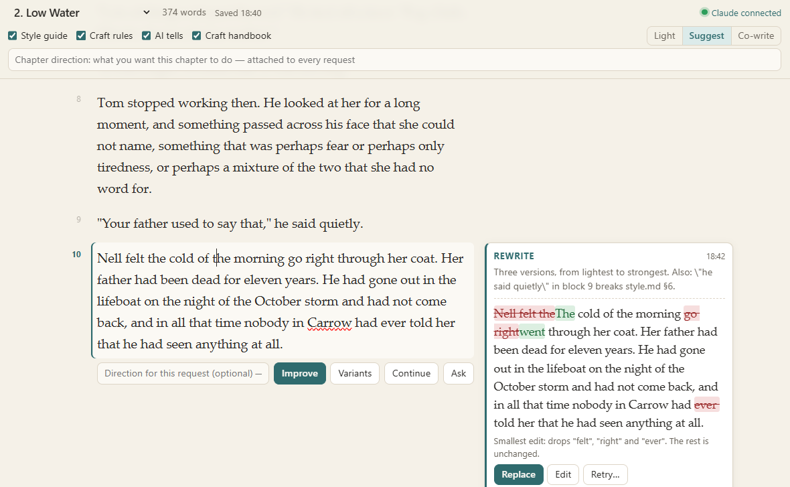

# Atelier

Atelier is a local page for editing a Markdown manuscript paragraph by paragraph, with Claude
in the margin. You select a passage, click Improve, Variants or Continue; the request goes into
your Claude Code conversation, and Claude's proposals come back next to the paragraph, with the
changed words highlighted. You apply, edit, retry or dismiss them. Claude never writes to the
manuscript itself.

<!-- Screenshot: not available yet. Add one here, e.g.  -->

## What you need

- **Python 3.9 or later.** The server uses only the standard library; nothing to install.
- **A recent browser.** The page is plain HTML, CSS and JavaScript with no external resources.
- **Claude Code**, for the bridge (the "mod" in `atelier/mod/`). Without it, Atelier still
  works: you copy each request into the conversation by hand (see [Without the mod](#without-the-mod)).

### Loading the mod

The mod is a Claude Code plugin whose only component is a TypeScript hooks module
(`atelier/mod/hooks/hooks.json` lists `register.ts` under `modules`). Load it for one session:

```bash
claude --plugin-dir path/to/claude-atelier/atelier/mod
```

or for every session, by putting the folder in the `CLAUDE_CODE_PLUGIN_DIRS` environment
variable (for example in the `env` section of your Claude Code `settings.json`).

What `register.ts` assumes about its environment, read from the code:

- a Claude Code version that runs hooks modules from plugins, and provides the `claude-code`
  module types it imports (`Register`, `EngineInterface`);
- on `session.start`, it registers two tools through `$.tool.register`; because the plugin is
  named `atelier`, Claude sees them as `mcp__atelier__state` and `mcp__atelier__propose`;
- it finds your home folder through the `USERPROFILE` or `HOME` environment variable, and reads
  `~/.atelier/active.json`, which the server rewrites every 10 seconds;
- while that file is fresh (less than 30 seconds old), it polls the request folder every second
  and submits each new request to the conversation with `$.prompt.submit({ asUser: true })`,
  that is, as if you had typed it; it also adds a short protocol to Claude's instructions
  (`prompt.compose`). When the server is stopped, the mod does nothing.

`claude plugin validate atelier/mod` checks the manifest; it does not run the module.

## Quick start

From the repository root:

```bash
python atelier --root examples/the-lighthouse
```

(or `python -m atelier.server --root examples/the-lighthouse`), then open
http://127.0.0.1:7340/. In another terminal, start Claude Code with the mod:

```bash
claude --plugin-dir atelier/mod
```

The page shows "Claude connected" once the mod is running. Click into a paragraph, select a
few words, and press **Improve**.

Options:

| Option | Default | Meaning |
|---|---|---|
| `--root` | current folder | the folder of your text |
| `--manuscript` | `.` | the chapter folder, relative to the root |
| `--style` | `style.md` | the style guide, relative to the root |
| `--annex FOLDER` | none | an extra folder of `.md` files (character sheets, notes) edited like chapters and listed after them; repeatable |
| `--state` | `~/.atelier/<root folder name>` | where requests and proposals are kept |
| `--port` | `7340` | the local port |

Chapters are the `.md` files of the chapter folder, sorted `ch01`, `ch02`, … first. Files with
an all-caps name (`README.md`) and the style guide are not listed. One paragraph per line, a
blank line between paragraphs.

**One Atelier at a time**: each server rewrites `~/.atelier/active.json`, which the mod reads to
know where to listen.

## Gestures

| Gesture | Effect |
|---|---|
| Enter | splits the paragraph in two; Backspace at the start of a block joins it back |
| Selection + **Improve** (Ctrl+Enter) | edits the selected passage, otherwise the paragraph |
| **Variants** | three clearly different versions |
| **Continue** (Ctrl+Shift+Enter) | one or two continuations, to insert after the paragraph |
| **Ask** | the question typed in the direction field, about this paragraph |
| Request direction field | the direction for this request only |
| Chapter direction | a direction attached to every request in the chapter |
| Style guide switch | Claude reads the style guide before proposing prose, if the file exists |
| Light / Suggest / Co-write | one edit, two or three proposals, or whole paragraphs |
| Replace / Insert after | applies the proposal to the text (and saves); **Undo** takes it back |
| Edit | edit the proposal before applying it |
| Retry… | sends the proposal back with a new direction |

From the conversation, a plain-language request about the open text ("two variants of the
station paragraph") also lands in the margin, tagged *conversation*: Claude calls
`mcp__atelier__state` to see what you are looking at, then `mcp__atelier__propose`.

## How it works

```
page (browser) ──HTTP──▶ local server ──files──▶ ~/.atelier/<project>/
                                                  requests/d-….json
mod "atelier" ◀── polls every second ─────────────┘
   │  submits the prompt to the conversation (as if typed by you)
   ▼
Claude ── tool mcp__atelier__propose ──▶ proposals/p-….json ──▶ page margin
```

- **The server** (`atelier/server.py`, standard library only) reads and writes the chapters,
  listens on 127.0.0.1 only, and serves a page that loads nothing external. It refuses to
  overwrite a chapter that was changed elsewhere in the meantime (SHA-1 hash) and says so.
- **The page** (`atelier/page/`, JavaScript without a framework): one field per block,
  autosave 1.2 s after the last keystroke, a margin per paragraph.
- **The mod** (`atelier/mod/`) forwards requests, declares the two tools, and adds the Atelier
  protocol to Claude's instructions. It stays silent when the server is not running.
- **The state** (requests, proposals, directions) lives in `~/.atelier/<project>/`, outside
  your manuscript folder.

A request not forwarded within 3 minutes is no longer sent automatically (it stays copyable),
so a mod that reloads does not replay a backlog.

## Without the mod

The page notices ("No bridge"): each request then offers **Copy the request**, which you paste
into any Claude conversation that can write files. Claude answers by writing the JSON file the
prompt names:

```json
{
  "request": "d-1108-124747-45ba",
  "chapter": "ch01", "block": 2,
  "target": "selection",
  "excerpt": "the exact piece replaced",
  "proposals": [{"text": "…", "why": "one line"}],
  "notes": [{"text": "…", "excerpt": "…", "rule": "style guide"}],
  "message": "one line at the top of the card"
}
```

`target`: `selection` (replaces the excerpt within the block), `paragraph` (replaces the
block), `after` (inserts after it). `block`: the number shown in the gutter, starting at 1.

## Privacy

- The server binds to `127.0.0.1` only. It rejects requests whose `Host` or `Origin` is not
  the Atelier page itself, and POSTs that are not `application/json`, so another web page open
  in your browser cannot submit a request to Claude in your name.
- The page is served with `Content-Security-Policy: default-src 'self'`: no external script,
  font or request.
- The state (which contains excerpts of your text) is kept in `~/.atelier/`, outside your
  manuscript folder, so it does not end up in your manuscript's repository.
- Your text reaches Claude only through your own Claude Code session, like anything else you
  type there.

## Tests

```bash
python -m unittest atelier.tests.test_atelier
```

from the repository root. They run on a made-up chapter in a temporary folder. The mod is
checked with `claude plugin validate atelier/mod`.

## License

MIT. See [LICENSE](LICENSE).
